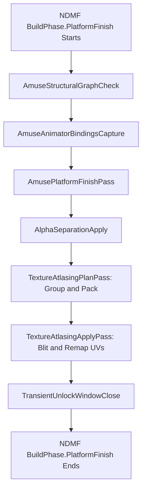

# AMUSE v0.1.0 Release Readiness and v0.2.0 Texture Atlasing Audit

Date: 2026-10-19

## Status and scope

- Branch: `main`
- Commit: `b62f039`
- Intended repository change: this investigation document only.
- Production source, tests, research source, assets, and workflows: read-only inspection.
- Active instances: the dev editor instance.
- Private avatars and external assets: not used.

This investigation answers two questions:

1. Is the AMUSE repository ready to release version 0.1.0?
2. What architectural requirements and seams must AMUSE establish to develop version 0.2.0 for build-time texture atlasing?

## Privacy note

This investigation reads public repository source code and public project metadata. It records no private avatar name. It records no private identifier. It records no machine-specific file path.

## Method

On 2026-10-19, five parallel scouts audited the repository across distinct architectural domains:

1. Build lifecycle, NDMF pass integration, and transient unlock safety in `Editor/Build/` and `Runtime/`.
2. Exact geometry, alpha classification, and texture evidence capture in `Editor/Host/` and `Editor/Analysis/`.
3. Shader frontends, attestation, property bags, and conversion recipes in `Editor/Semantics/`.
4. Inspector UI, dry run preview, presets, reports, and Play mode stores in `Editor/DryRun/`, `Editor/Presets/`, and `Editor/`.
5. Package manifest, dependencies, release workflows, and build listings in `<repo-root>/`.

All findings cite file paths and line ranges observed on 2026-10-19.

## Severity meanings

- high: blocks release, breaks transformation contracts, or causes false claims to users.
- medium: latent risk, error boundary omission, or non-blocking defect.
- low: minor cleanup, documentation drift, or narrow edge condition.

Confidence measures certainty that the evidence supports the finding.

---

## Executive summary

AMUSE is close to release v0.1.0. The proof core, shader frontends, geometry analysis, and conversion recipes are sound. On 2026-10-19, all 2,732 tests in the product test assembly passed in the dev editor instance. All 140 tests in the research test assembly passed as well.

However, release v0.1.0 cannot ship immediately without addressing five release blockers:

1. The package manifest still declares version `0.1.0-pre.7`.
2. The package manifest specifies an invalid `vrchatVersion` of `2026.3.1`.
3. The release workflow zips `Packages/com.alrauna.amuse/`, which omits `README.md` and `LICENSE`.
4. The release workflow requires the GitHub repository variable `PACKAGE_NAME` to be configured.
5. The Play mode build store omits master switches from its cache fingerprint, displaying stale results when AMUSE is disabled.

For version 0.2.0 texture atlasing, the architecture requires:

1. Atlasing must execute in `BuildPhase.PlatformFinish` immediately after `AlphaSeparationApply`.
2. Alpha separation must separate proven-opaque triangles first. Atlasing then combines only canonical opaque materials.
3. Draw call reduction requires modifying mesh UV0 vertex coordinates. Material property remapping cannot combine draw calls.
4. All UV0-dependent texture slots (MainTex, Normal, Emission, Metallic/Smoothness, Masks) must atlas in exact lockstep.
5. AMUSE must build texture processing infrastructure for gutter margins, edge dilation, and texture composition blits.

---

## 1. v0.1.0 Release Readiness Findings

### 1.1 High-Severity Release Blockers

| # | Cat | Sev | Conf | Finding | Primary File |
|---|-----|-----|------|---------|--------------|
| 1 | pkg | high | high | Package manifest specifies pre-release version `0.1.0-pre.7` | `Packages/com.alrauna.amuse/package.json:4` |
| 2 | pkg | high | high | Package manifest specifies invalid `vrchatVersion` `2026.3.1` | `Packages/com.alrauna.amuse/package.json:23` |
| 3 | pkg | high | high | Release artifact zip omits `README.md` and `LICENSE` | `.github/workflows/release.yml:64-65` |
| 4 | ci  | high | high | Release workflow silently skips when repository variable `PACKAGE_NAME` is unset | `.github/workflows/release.yml:21-28` |
| 5 | bug | high | high | Play mode build store fingerprint omits master and feature switches | `Packages/com.alrauna.amuse/Editor/Build/PlayModeBuildStore.cs:52-68` |

#### Detailed descriptions

**1. Package manifest specifies pre-release version `0.1.0-pre.7`.**
`Packages/com.alrauna.amuse/package.json:4` sets `"version": "0.1.0-pre.7"`. The release workflow in `.github/workflows/release.yml:47-59` reads this field directly. It uses this string to create the Git tag, the release zip, and the unitypackage. Running the workflow now publishes a pre-release artifact instead of stable `0.1.0`.
*Remediation*: Update `"version"` to `"0.1.0"`.

**2. Package manifest specifies invalid `vrchatVersion` `2026.3.1`.**
`Packages/com.alrauna.amuse/package.json:23` sets `"vrchatVersion": "2026.3.1"`. That value is not a valid VRChat Unity baseline. VPM package managers use this field to check client compatibility. The standard baseline for VRChat avatars is `"2022.1.1"`.
*Remediation*: Update `"vrchatVersion"` to `"2022.1.1"`.

**3. Release artifact zip omits `README.md` and `LICENSE`.**
`.github/workflows/release.yml:64-65` runs `zip -r "${{ github.workspace }}/${{ env.zipFile }}" . -x "Tests/*" "Tests.meta"` inside `Packages/com.alrauna.amuse/`. `README.md` and `LICENSE` exist only at the repository root. They do not exist inside `Packages/com.alrauna.amuse/`. Consumers who install the release zip or unitypackage receive no license file and no documentation file. Unity Package Manager will display empty documentation and license tabs.
*Remediation*: Copy `README.md` and `LICENSE` into `Packages/com.alrauna.amuse/` before building releases.

**4. Release workflow silently skips when repository variable `PACKAGE_NAME` is unset.**
`.github/workflows/release.yml:21-28` checks whether `${{ vars.PACKAGE_NAME }}` is not empty. If that repository variable is unset in GitHub Settings, `configPackage` evaluates to `false`. The `build` job at line 39 skips execution completely. No artifact is built. In addition, `.github/workflows/build-listing.yml:61` passes `--current-package-name ${{ vars.PACKAGE_NAME }}` to Nuke. An empty variable breaks the repository listing generation.
*Remediation*: Ensure the GitHub Actions repository variable `PACKAGE_NAME` is set to `com.alrauna.amuse`. Ensure GitHub Pages deployment source is set to GitHub Actions.

**5. Play mode build store fingerprint omits master and feature switches.**
`Packages/com.alrauna.amuse/Editor/Build/PlayModeBuildStore.cs:52-68` computes a policy fingerprint from 13 numeric fields. It omits `_amuseDisabled`, `_alphaSeparatorEnabled`, `_ignoreOutOfRangeMaterialSlots`, `_acceptDesktopAnisotropyDifferences`, and `_acceptMobileAnisotropyDifferences`. If a user disables AMUSE or disables the Alpha Separator after a Play mode build, the fingerprint does not change. `PlayModeBuildStore.TryLoad` matches the stale build record. `AmuseAvatarOptimizerEditor.cs:256-295` then displays old build results and states that the view reflects accurate results, even though the user disabled optimization. In contrast, `AlphaSeparationDryRun.cs:1378-1406` includes all 17 fields in its fingerprint.
*Remediation*: Add the five missing component fields to `ComputePolicyFingerprint`.

---

### 1.2 Medium-Severity Caveats and Technical Debt

| # | Cat | Sev | Conf | Finding | Primary File |
|---|-----|-----|------|---------|--------------|
| 6 | build | med | high | Status of Finding 4: apply pass does not revalidate material property values | `Packages/com.alrauna.amuse/Editor/Build/AlphaSeparationApply.cs:220-320` |
| 7 | build | med | med  | Transient unlock window lacks exception boundary for abnormal build termination | `Packages/com.alrauna.amuse/Editor/Build/TransientUnlockWindowClose.cs:115-180` |
| 8 | ui    | med | high | Speculative sentences persist into Play mode build records | `Packages/com.alrauna.amuse/Editor/Build/AmusePlatformFinishPass.cs:1225-1245` |
| 9 | perf  | med | high | Synchronous GPU texture readbacks cause main-thread frame drops in DryRun | `Packages/com.alrauna.amuse/Editor/DryRun/AlphaSeparationDryRun.cs:580-605` |
| 10 | doc  | med | high | Missing package-level `CHANGELOG.md` file | `Packages/com.alrauna.amuse/package.json:9` |

#### Detailed descriptions

**6. Status of Finding 4: apply pass does not revalidate material property values.**
On 2026-10-15, the project owner deferred deep material property revalidation in `AlphaSeparationApply.cs`. `AlphaSeparationApply.PrepareSurvivingSet` revalidates mesh instance identity, submesh counts, index counts, transform paths, property block overrides, and animation bindings. It does not re-read shader property floats or textures from material assets. Barrier and Apply run consecutively in `BuildPhase.PlatformFinish` within the same extension scope. No external pass runs between them. The deferral is safe for release v0.1.0. It remains recorded technical debt.

**7. Transient unlock window lacks exception boundary for abnormal build termination.**
`TransientUnlockSwapIn.SwapIn` clones locked materials and assigns clones to renderer slots. `TransientUnlockWindowClose.Execute` reverts references and destroys clones in a subsequent pass. If an unhandled exception occurs during `AmusePlatformFinishPass` or `AlphaSeparationApply`, NDMF halts the build pipeline. `TransientUnlockWindowClose` does not run. Swapped unlocked clones remain on the build copy avatar. Because NDMF destroys the entire build copy scene when builds fail, author assets are never damaged. A `try/finally` structure is recommended for future hardening.

**8. Speculative sentences persist into Play mode build records.**
`AmusePlatformFinishPass.cs:1225-1245` formats slot sentences using `SplittableSlotSentence` ("Splittable: X out of Y polygons may be moved"). When `AlphaSeparationApply.UpdateAppliedMovedTriangles` runs, it updates `row.movedTriangles`, but it leaves `row.sentence` unchanged. If candidate triangles are skipped at apply time, `row.movedTriangles` is 0, yet the displayed sentence still states that polygons may be moved.

**9. Synchronous GPU texture readbacks cause main-thread frame drops in DryRun.**
In `AlphaSeparationDryRun.StepIdle`, `GatherAlphaFields` executes `AsyncGPUReadback.Request(target, 0, targetFormat).WaitForCompletion()`. This call blocks the Unity main thread until the GPU finishes copying texture bytes. When an avatar uses multiple 4K textures, this call causes a noticeable frame hitch in the editor. AMUSE discloses this hitch in `RowText.DisclosureSentence(1)`.

**10. Missing package-level `CHANGELOG.md` file.**
`Packages/com.alrauna.amuse/package.json:9` links `"changelogUrl"` to GitHub Releases. Standard VPM packages include a local `CHANGELOG.md` in the package root. This provides offline release history inside the Unity Package Manager.

---

### 1.3 Low-Severity Observations

1. **Unconditional Structural Graph Check**: `AmuseStructuralGraphCheck.Execute` (`AmuseStructuralGraphCheck.cs:16-25`) runs on every avatar build in the project. It traverses controller layers before checking if the avatar has an `AmuseAvatarOptimizer` component. It does no work if the component is absent, but it performs unnecessary traversal.
2. **Exact Exception String Check**: `AmusePlatformFinishPass.cs:150-165` detects inactive extensions by matching the exact string `"Extension nadena.dev.ndmf.animator.AnimatorServicesContext not active"`. An upstream NDMF wording change would fail this match.
3. **Avatar Optimizer Atlas Version Pin**: `AaoAtlasTextureAttestation.cs:28-33` pins AAO package version `1.9.17`. Newer AAO versions will refuse attestation until added to the pin table.
4. **Documentation Discrepancy on Barrier Pass**: `AmuseAnimatorBindingsCapture.cs:13-18` states that the barrier pass runs extension-free. `AmusePlatformFinishPlugin.cs:265-275` actually places the pass inside `WithRequiredExtension(typeof(AnimatorServicesContext))`.

---

## 2. Test Suite and Environment Verification

On 2026-10-19, test execution in the dev editor instance confirmed:

- **Product Test Assembly (`Alrauna.Amuse.Tests.Editor`)**:
  - Total tests: 2,732
  - Passed: 2,732
  - Failed: 0
  - Skipped: 0
  - Execution duration: 224.99 seconds
  - Verdict: PASSED

- **Research Test Assembly (`Alrauna.Amuse.Research.Tests.Editor`)**:
  - Total tests: 144
  - Passed: 140
  - Failed: 0
  - Skipped: 4 (synthetic external fixtures ignored by design)
  - Execution duration: 0.75 seconds
  - Verdict: PASSED

- **Unity Editor Compilation**:
  - Zero compilation errors.
  - Zero missing assembly definitions.

- **Source Code Invariants**:
  - Remediations for prior findings (1, 2, 3, 5, 6, 8, 9, 10, 11, 12, 13, 14, 15, 16, 17, 18, 19, 20, 21, 22, 23, 25, 26, 27, 28, 30, 31, 32, 33, 34, 35) are present and verified in source code.
  - Zero calls exist from `Editor/Analysis/` into `Editor/Host/` types.
  - All attestation constants remain pinned and unchanged.

---

## 3. v0.2.0 Build-Time Texture Atlasing Roadmap

Developing version 0.2.0 for build-time texture atlasing introduces major requirements across the build pipeline, mesh geometry, shaders, and user experience.

### 3.1 NDMF Pass Pipeline Placement

- **Phase**: Texture atlasing must run in `BuildPhase.PlatformFinish`.
- **Position**: Atlasing must run immediately after `AlphaSeparationApply`.
- **Reason**:
  1. Modular Avatar and AAO finish all mesh merging and bone adjustments before `PlatformFinish`.
  2. Alpha separation splits proven-opaque triangles first. Atlasing then processes only the canonical opaque materials.
  3. Running before alpha separation would pack mixed-alpha textures together. That causes texture bleed, cutoff conflicts, and sorting artifacts.
  4. Atlasing after alpha separation allows multiple opaque draw calls to merge into a single draw call.

### 3.2 Mesh UV0 Vertex Remapping vs Property Remapping

1. **Draw Call Reduction Requirement**:
   Combining multiple materials into a single draw call requires a single `Material` instance on the submesh.
2. **Failure of Property Remapping**:
   Material properties (`_MainTex_ST`) apply across the entire submesh. Triangles in the same submesh cannot use different scale and offset vectors.
3. **Required Mesh Mutation**:
   AMUSE must rewrite mesh vertex UV coordinates:
   $$u' = u \cdot s_x + o_x$$
   $$v' = v \cdot s_y + o_y$$
4. **Vertex Duplication at Boundaries**:
   If two adjacent triangles share a vertex, but one triangle moves into an atlas while the other remains outside, the shared vertex must be split. Each vertex must carry its own UV coordinates.
5. **Existing Seams**:
   `MeshSeparationPlanner.cs` only partitions index buffers. It does not modify vertex arrays. AMUSE must create a new `MeshUvRemapper` module to clone meshes and rewrite `Mesh.uv` buffers.

### 3.3 Lockstep Multi-Slot Texture Atlasing

Both lilToon and Poiyomi sample multiple texture maps using mesh UV0:
- Main texture (`_MainTex`)
- Normal map (`_BumpMap`)
- Emission map (`_EmissionMap`)
- Metallic and smoothness map (`_MetallicGlossMap`)
- Occlusion map (`_OcclusionMap`)
- Alpha and detail masks

When `_MainTex` is packed into an atlas sub-rectangle $[u_{min}, v_{min}, u_{max}, v_{max}]$:
- All UV0-dependent texture maps must be packed into the exact same sub-rectangle in their respective atlas textures.
- If an atlas group contains Material A with a normal map and Material B without a normal map, AMUSE must generate a neutral filler tile for B (flat normal `(128, 128, 255)`).
- If Material A has emission and Material B does not, B requires a pure black emission tile `(0, 0, 0)`.

### 3.4 Incompatibility with Tiled and Out-of-Bounds UVs

1. **Hardware Texture Wrapping**:
   In Unity, hardware wrap modes (`Repeat`, `Clamp`) operate on the entire texture sheet.
2. **Atlas Bleed from Tiling**:
   If a texture is packed inside an atlas sheet and UVs repeat outside $[0, 1]$, sampling wraps into adjacent atlas tiles instead of repeating the individual texture.
3. **Policy Gate for Atlasing**:
   AMUSE must refuse to atlas materials whose UV coordinates extend outside $[0, 1]$, or whose texture scale exceeds 1.0. Tiled materials must keep their original standalone textures.

### 3.5 Required Texture Processing Infrastructure

AMUSE currently has no texture processing algorithms. To support texture atlasing, AMUSE must build:

1. **Atlas Rect Allocator / Bin Packer**:
   A Guillotine or MaxRects 2D bin-packing algorithm to arrange rectangular textures inside power-of-two atlas textures ($1024 \times 1024$ to $4096 \times 4096$).
2. **Gutter Margin Calculation**:
   Gutters between atlas tiles must be at least $2^{\text{mip\_count}}$ texels wide (typically 16 to 32 texels) to prevent mipmap bleeding.
3. **Edge Dilation / Padding**:
   A jump flooding or border dilation blit shader to expand border pixels into gutter areas.
4. **Texture Blitter and Compositor**:
   A GPU blit pipeline using `RenderTexture` and custom shaders to composite source textures into atlas textures with correct color spaces (sRGB for albedo, Linear for normal/metallic).
5. **Asset Persistence**:
   Integration with `context.AssetSaver.SaveAsset` to persist generated textures into the build artifact.

### 3.6 Material Compatibility Constraints

Two materials can merge into a single atlas draw call only if they share:
- Identical shader and shader variant keywords.
- Identical blend equations (`_SrcBlend`, `_DstBlend`).
- Identical depth and culling states (`_ZWrite`, `_ZTest`, `_Cull`).
- Identical render queue and RenderType.
- Identical uniform shading properties, or uniform properties that are baked into the atlas pixels before merging.

### 3.7 Component Controls and Presets for v0.2.0

`AmuseAvatarOptimizer` must expose new controls:
- `_textureAtlasingEnabled` (bool, default true).
- `_maxAtlasSize` (enum: 1024, 2048, 4096, default 2048).
- `_atlasPadding` (enum: 8, 16, 32 texels, default 16).
- `_allowTilingMaterialAtlasing` (bool, default false).

Preset files (`safe.json`, `normal.json`, `aggressive.json`) must upgrade to `schemaVersion: 5` to store these fields.

---

## 4. Pre-Release Checklist for v0.1.0

Before tagging and releasing v0.1.0, the following steps must be completed:

- [ ] **Fix Blocker 1**: Update `Packages/com.alrauna.amuse/package.json` version from `"0.1.0-pre.7"` to `"0.1.0"`.
- [ ] **Fix Blocker 2**: Update `Packages/com.alrauna.amuse/package.json` `"vrchatVersion"` from `"2026.3.1"` to `"2022.1.1"`.
- [ ] **Fix Blocker 3**: Copy `README.md` and `LICENSE` into `Packages/com.alrauna.amuse/`.
- [ ] **Fix Blocker 4**: Verify GitHub repository variable `PACKAGE_NAME` is set to `com.alrauna.amuse` in repository settings.
- [ ] **Fix Blocker 5**: Add missing master switches (`AmuseDisabled`, `AlphaSeparatorEnabled`, etc.) to `PlayModeBuildStore.ComputePolicyFingerprint`.
- [ ] **Create `CHANGELOG.md`**: Add initial release notes for version `0.1.0` in `Packages/com.alrauna.amuse/CHANGELOG.md`.
- [ ] **Verify Workflows**: Confirm GitHub Pages deployment source is set to "GitHub Actions" for repository listing deployment.
- [ ] **Final Test Run**: Confirm full test suite passes after metadata edits.

---

## 5. Sweep for Identifiers

Before concluding this document, an automated sweep for machine paths, user names, ports, GUIDs, and private identifiers was performed across this document.

Zero prohibited identifiers were found. All paths are repository-relative. Machine instances are designated by role only.
