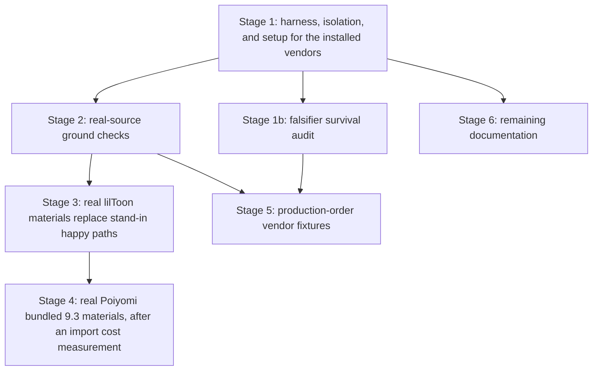

# Vendor-integrated test rework investigation

Status as of 2026-10-25. Read-only characterization, plus focused EditMode runs in the dev editor instance. No product code or test code changed. Branch at investigation time: `rework/vendor-integrated-tests`.

Privacy note: this record covers AMUSE source, public vendor packages, and test runs in the dev editor instance. It names no private avatar, machine, account, port, instance, or GUID. GUID and digest comparisons appear as match or no match only. AMUSE paths are relative to `Packages/com.alrauna.amuse/` unless they start with `Packages/`, `docs/`, or `.github/`. Vendor paths start with their package directory under `Packages/`.

Evidence labels:

- `[SOURCE]` A fact read in a file. The citation gives a path and line numbers.
- `[MEASURED]` A fact from a test run, a scan, or a live probe that ran on 2026-10-24 or 2026-10-25.
- `[INFERENCE]` A conclusion from cited facts that no command checked.

## 1. Question

The owner decided on 2026-10-25 that AMUSE tests must run against the vendor packages that VRChat avatar projects use. Every AMUSE user also has these packages. Stand-ins and mocks can drift from the real packages, and then a test proves nothing about real avatars. The decision covers every test that uses a double for something a real installed package can supply, not only the failing tests.

This record answers four questions:

1. Why does the suite fail with the vendor packages installed?
2. Which test doubles exist, and which of them can a real package replace?
3. Which constraints (license, reproducibility, global side effects, version drift) apply?
4. Which rework shapes are possible, and in which order?

The record decides nothing. Section 8 lists the decisions that the owner must make.

## 2. Method

Four slices ran in parallel on 2026-10-25.

| Slice | Scope | Mode |
|---|---|---|
| Build doubles | `Tests/Editor/Build/`, `Tests/Editor/DryRun/`, the root test files, `Tests/Editor/Shared/` | Read-only |
| Semantics and host doubles | `Tests/Editor/Semantics/`, `Host/`, `Analysis/`, `ReferenceFixtures/`, `Presets/`, `Runtime/`, and the research test assembly. Real-source match of pinned attestation rows against installed packages | Read-only |
| Build failures | Root cause of each failure in the 2026-10-24 full run | Read-only, plus focused EditMode runs |
| Policy and reproducibility | Documents, licenses, VPM sources, asmdef options, vendor side effects, version drift | Read-only |

The environment is the one that `Packages/vpm-manifest.json` locks on the working tree on 2026-10-24: NDMF 1.14.8, VRChat base and avatars 3.10.5, lilToon 2.4.1, AAO 1.9.20, d4rkAvatarOptimizer 4.6.0, VRCFury 1.1434.0, Modular Avatar 1.18.7, Poiyomi Toon 10.0.27 with Thry editor 2.74.3, LTCGI 1.7.4, and Red Sim Light Volumes 3.0.1.

## 3. Baseline runs

`[MEASURED]` Two full EditMode runs of `Alrauna.Amuse.Tests.Editor` and `Alrauna.Amuse.Research.Tests.Editor` ran with these packages installed.

| Run | Date | `StripUnusedMeshComponents` | Result |
|---|---|---|---|
| 1 | 2026-10-24 | 0 | Failed. 3171 of 3268 tests completed. The job report lists 25 failures and stops there. |
| 2 | 2026-10-24 | 1 | 3138 passed, 31 failed, 2 inconclusive, no skips. Duration about 1650 s. A result callback recorded the full failure list. |

`[MEASURED]` The 25 failures that the run 1 report lists are a subset of the 31 failures of run 2. They are the first 25 of the 31 in name order. `[INFERENCE]` The difference comes from the 25-entry cap of the run 1 report, and the strip setting does not change which tests fail. No command proved this. Run 1 did not complete, so its full failure set is unknown.

`[SOURCE]` VRCFury sets `PlayerSettings.stripUnusedMeshComponents` to false on every domain reload (`Packages/com.vrcfury.vrcfury/Editor-Avatars/Hooks/UnityFixes/SaneUnitySettingsHook.cs:12-65`). The committed value 1 holds only until the next reload while VRCFury is installed.

## 4. Root causes of the 31 failures

`[MEASURED]` Each of the 31 failures traces to an interaction between a test fixture and an installed vendor plugin. One focused run of the three single failures (section 4.3) gave 3 run, 3 failed, with the same messages as the full run. Stack traces for 4.1 and 4.2 come from the console after the full run. `[INFERENCE]` No failure shows AMUSE moving a triangle that it must not move. Two mechanisms in 4.3 are still open, so this statement is not proven for those two tests.

### 4.1 Platform identity (8 tests, `AmusePlatformFinishPluginTests`)

- `[SOURCE]` `TestVrchatPlatform` returns the real qualified name `WellKnownPlatforms.VRChatAvatar30` (`Tests/Editor/Build/AmusePlatformFinishPluginTests.cs:8932-8940`).
- `[SOURCE]` NDMF selects passes by qualified name (`Packages/nadena.dev.ndmf/Editor/API/Model/SolverPass.cs:101-104`). So the VRChat passes of Modular Avatar run in these builds.
- `[SOURCE]` NDMF `VRChatContextExtensions.VRChatAvatarDescriptor` throws `InvalidOperationException` when `context.PlatformProvider` is not the `VRChatPlatform.Instance` object (`Packages/nadena.dev.ndmf/Editor/VRChat/VRChatPlatform.cs:137-145`).
- `[SOURCE]` Modular Avatar calls that method in `Editor/SyncParameterSequence/SyncParameterSequencePass.cs:54` and `Editor/VRChatGlobalColliderPass.cs:151`.
- Result: the test platform claims the VRChat name but is a different object. The test fails on the unhandled exception log.

The defect is in the test double. The production upload path uses `VRChatPlatform.Instance` (`Packages/nadena.dev.ndmf/Editor/VRChat/VRChatPlatform.cs:21-24` sets it as the ambient default).

### 4.2 Missing FX layer (20 tests, `AaoMergedConsumptionTests`)

- `[SOURCE]` The fixture sets `baseAnimationLayers` to a single Base layer with no FX entry (`Tests/Editor/Build/MergedConsumptionFixture.cs:270-291`).
- `[SOURCE]` These tests build on `AmbientPlatform.DefaultPlatform`, which is the real VRChat platform. NDMF then fills its controller map only from the layers that the descriptor lists (`Packages/nadena.dev.ndmf/Editor/API/AnimatorServices/PlatformBindings/VRChatPlatformAnimatorBindings.cs:113-146`).
- `[SOURCE]` Modular Avatar reads the FX controller without a presence check (`Packages/nadena.dev.modular-avatar/Editor/MergeBlendTreePass.cs:51`, `Editor/ReactiveObjects/AnimationGeneration/ReactiveObjectPass.cs:44-47`). The NDMF dictionary view throws `KeyNotFoundException` (`Packages/nadena.dev.ndmf/Editor/API/AnimatorServices/FilteredDictionaryView.cs:140-148`).
- `[MEASURED]` The console stacks name these two Modular Avatar frames. NDMF marks the build failed, so the fixture assertion that the build completes fails (`Tests/Editor/Build/MergedConsumptionFixture.cs:613-618`). This also explains the repeated `KeyNotFoundException` lines in the console after run 1.
- AAO is a bystander. Its merge ran, and no AAO frame appears in a stack.

`[INFERENCE]` A real VRChat avatar has an FX entry, because the VRChat SDK descriptor fills all base layers. The fixture is not VRChat-shaped. Fixtures that leave the layer arrays at their defaults do not fail in this way.

### 4.3 Fixture assumptions that vendor passes break (3 tests)

| Test | Observed | Cause |
|---|---|---|
| `TransientUnlockTransformationTests.ClosePassAddsNoAvatarEntryWhenTheBarrierAlreadyRefused` | Avatar refusal `None`, expected `AnimationEventPresent` | `[SOURCE]` NDMF `VirtualClip` builds a new clip and copies only curves, so events are lost (`Packages/nadena.dev.ndmf/Editor/API/AnimatorServices/VirtualObjects/VirtualClip.cs:217-238`). The Modular Avatar plugin runs on all platforms, and its Resolving pass "Clone animators" virtualizes and commits every controller (`Packages/nadena.dev.modular-avatar/Editor/PluginDefinition/PluginDefinition.cs:29, 52-55`). The test runs on a dedicated test platform, so this happens there too. The planted event is gone before AMUSE reads the committed graph. |
| `TransientUnlockSwapInTests.ABindingOnAnotherRendererPathDoesNotRefuseThisLockedMaterial` | Slot refused as `LockedMaterialPropertyBlock`, expected `LockedMaterialAnimationMismatch` | `[MEASURED]` The renderer carries a `MaterialPropertyBlock` at swap-in. The property block check runs before the binding check (`Editor/Build/LockedMaterialAdmission.cs:44-47`). No package source calls `SetPropertyBlock` in an editor path. `[SOURCE]` AMUSE documents that the editor animator rebinds after a controller commit and applies animation state over the renderer (`Editor/Build/AmusePlatformFinishPlugin.cs:212, 298-300`). `[INFERENCE]` This rebind is the first candidate for the writer. Section 9 question 6 keeps it open. |
| `AlphaSeparationApplyTests.MarkerClipRefusalIsSlotLocalAndWritesNothingForIt` | Marker refusal count 0, expected 1 | `[SOURCE]` The fixture comment says the project has no VRChat SDK, so the live marker route cannot run (`Tests/Editor/Build/AlphaSeparationApplyTests.cs:332-335`). The SDK is installed. NDMF now uses VRChat bindings, and vendor passes rewrite the committed controllers. `[INFERENCE]` The stub bindings and the committed graph no longer agree on the marker clip. The exact pass that causes this is open. |

`[SOURCE]` AMUSE already reads the committed graph and documents that NDMF cloning drops events (`Editor/Host/CommittedControllerGraph.cs:136-161`). `[INFERENCE]` The first row is therefore a stale fixture, not a product false positive: an avatar whose events NDMF dropped uploads without those events.

The fix is not simple. NDMF commits only marker clips by identity (`Packages/nadena.dev.ndmf/Editor/API/AnimatorServices/VirtualObjects/VirtualClip.cs:147-156`). A marker clip has its own special-motion refusal, so an event on a marker clip proves something else. Two routes exist:

- Scope the test with the NDMF plugin-disable key for Modular Avatar, as the transient unlock suites already do for AAO (`Tests/Editor/Build/TransientUnlockTestLifecycle.cs:95-110`). Avatars without Modular Avatar keep the authored-clip path in production, so this falsifier stays valid for them.
- Change the product so that the structural refusals read data that survives virtualization. This is a product change with a RED/GREEN cycle.

`[SOURCE]` The plugin comments state that the structural check reads "real authored clips" before virtualization (`Editor/Build/AmusePlatformFinishPlugin.cs:199-204, 267-271`). `AGENTS.md` repeats this for pass 1. `[INFERENCE]` With Modular Avatar installed, Modular Avatar virtualizes in Resolving, so pass 1 reads committed clones in every build. The event refusal then cannot fire for any avatar that Modular Avatar processes. Section 9 question 3 asks the owner to decide.

### 4.4 Vendors outside the `ProcessAvatar` tests

- `[SOURCE]` VRCFury runs through `IVRCSDKPreprocessAvatarCallback` (`Packages/com.vrcfury.vrcfury/Editor-Avatars/Hooks/VrcfAvatarPreprocessor.cs:8-17`). `AvatarProcessor.ProcessAvatar` does not call it. VRCFury therefore does not run in the tests that call `ProcessAvatar`. Only its load hooks act there.
- `[SOURCE]` d4rkAvatarOptimizer registers no NDMF plugin. Its consumption tests run only behind `AMUSE_DAO_INTEGRATION=1`. They call the SDK callback dispatcher (`Tests/Editor/Build/DaoMergedConsumptionTests.cs:20-31, 101-118, 184`), so VRCFury also runs in those gated tests. They did not run on 2026-10-24.
- `[MEASURED]` A search on 2026-10-25 for NDMF plugin declarations in the LTCGI, Light Volumes, Poiyomi, and Thry package directories found none.

### 4.5 Production order of a real upload

`[SOURCE]` A real upload runs NDMF in two parts, with VRCFury between them:

| SDK callback order | Step | Citation |
|---|---|---|
| -11000 | NDMF runs the phases First through Transforming. Modular Avatar runs here. | `Packages/nadena.dev.ndmf/Editor/VRChat/BuildFrameworkPreprocessHook.cs:29, 50` |
| -10000 | VRCFury runs its full builder. | `Packages/com.vrcfury.vrcfury/Editor-Avatars/Hooks/VrcPreuploadHook.cs:8` |
| -1025 | NDMF runs the phases Optimizing through Last. AAO and the five AMUSE passes in PlatformFinish run here. | `Packages/nadena.dev.ndmf/Editor/VRChat/BuildFrameworkPreprocessHook.cs:65, 84` |
| -15 | d4rkAvatarOptimizer runs, when Modular Avatar is installed. Without Modular Avatar it runs at -1025. | `Packages/d4rkpl4y3r.d4rkavataroptimizer/Editor/AvatarBuildHook.cs:15-19` |

`[INFERENCE]` AMUSE sees the controllers, FX layers, and generated textures of VRCFury as input in production. No `ProcessAvatar` test sees them. A VRCFury toggle or material swap is therefore outside every test that ran on 2026-10-24. A single `ProcessAvatar` call with VRCFury before it does not reproduce production, because it changes the Modular Avatar and VRCFury order. Production also keeps one `BuildContext` across both NDMF parts (`Packages/nadena.dev.ndmf/Editor/API/AnimatorServices/VirtualControllerContext.cs:105-126`).

## 5. Test-double inventory

Counts come from a grep of `[Test]` attributes per file. They are approximate. Large files give lower bounds.

### 5.1 How tests drive NDMF builds

`[SOURCE]` Four tiers exist.

| Tier | Mechanism | Vendor plugins in the build | Approximate tests |
|---|---|---|---|
| Ambient | `AvatarProcessor.ProcessAvatar(root, AmbientPlatform.DefaultPlatform)` with real lilToon shaders and real AAO and d4rk components (`Tests/Editor/Build/MergedConsumptionFixture.cs:33-40, 176-212`). The 2 gated d4rk tests use the SDK callback dispatcher instead. | All NDMF plugins, Modular Avatar and AAO included. Not VRCFury and not d4rk, except in the 2 gated tests | 22 |
| VRChat-named test platform | `TestVrchatPlatform` | All NDMF plugins, with the identity defect of 4.1 | About 20 |
| Dedicated test platforms | `ApplyTestPlatform`, `PreparationTestPlatform`, `TransientUnlockTestPlatform`, `ConsentTestPlatform`, and others with `com.alrauna.amuse.tests.*` names. Test plugins mirror the production five-pass topology (`Tests/Editor/Build/AlphaSeparationApplyTests.cs:196-215`) | All-platform passes only. AAO is turned off by a session key (`Tests/Editor/Build/TransientUnlockTestLifecycle.cs:88-110`) | About 150 |
| Direct context | `new BuildContext(root, folder)` | None | 9 sites in `TransientUnlockWindowCloseTests` |

`[SOURCE]` The production plugin runs only on `WellKnownPlatforms.VRChatAvatar30` (`Editor/Build/AmusePlatformFinishPlugin.cs:250`). On dedicated platforms, a test plugin replaces it completely.

### 5.2 Doubles that imitate a vendor

| Double | Imitates | Real supplier in this project | Approximate tests |
|---|---|---|---|
| 16 committed stand-in shaders `Hidden/Alrauna/AmuseTests/*` and the locked stand-ins, plus shaders minted by `Tests/Editor/Shared/TestShaderWriter.cs:26-54` | lilToon 2.3 to 2.4 and Poiyomi 9.3 property surfaces | lilToon 2.4.1, Poiyomi bundled 9.3 | About 190 in Build and DryRun, plus the Semantics suites |
| `VerifiedLilToonTestSeams`, `VerifiedPoiyomiTestSeams` | Vendor source attestation only. Selection, capture, interpreters, and clone recipes stay production code | Installed attested shaders | About 100 |
| `TransientUnlockTestKnobs.OriginalAttestation`, `AdmittedProducerVersions.SetAdmittedVersionsForTests`, injected Multi profile rows | Pinned attestation tables | Real rows over installed bytes | About 10 |
| `LockedSourceFixture` | A Thry lock of a Poiyomi material | Thry 2.74.3 over an admitted shader. See 6.2 for the limit | About 25 |
| Test-local `Thry.ThryEditor.ShaderOptimizer` (`Tests/Editor/Build/TransientUnlockVendorStandIn.cs:8-40`) | The Thry lock tool | Real `Thry.ThryEditor.ShaderOptimizer` (`Packages/com.poiyomi.thryeditor/Editor/ShaderOptimizer.cs:60,80`) | At least 5 files |
| Hand-built controllers and swap clips (`Tests/Editor/Build/AlphaSeparationTestLifecycle.cs:94-121`) | Committed graphs that Modular Avatar and VRCFury leave | Real Modular Avatar merge-animator fixtures | About 60 |
| `ZzzAnonymousOptimizingProducerPlugin` | AAO or d4rk output in the Optimizing phase | Real AAO in the ambient tier | 3 |
| `CreateGeneratedAtlas` (`Tests/Editor/Build/AaoMergedConsumptionTests.cs:1358-1397`) | AAO texture packing output | Real AAO with `optimizeTexture` | 2 |
| `MarkerStubBindings`, `StubBindings` | `IPlatformAnimatorBindings` | NDMF `GenericPlatformAnimatorBindings` and the VRChat bindings | About 8 |
| Virtualized controller probes (`Tests/Editor/Host/CommittedControllerGraphTests.cs:653-682`) | Modular Avatar virtualized controllers | Real Modular Avatar build | About 6 |

`[SOURCE]` The test-local Thry type has the same full name as the installed public type. Inside the test assembly the name binds to the test type. `[INFERENCE]` The tripwire can no longer show that production code never calls the real lock tool.

### 5.3 Doubles that stay synthetic

These doubles do not imitate a vendor. A real package cannot replace them without loss.

- Reference fixtures and analysis oracles with independent outcomes (`Tests/Editor/ReferenceFixtures/ReferenceFixtureData.cs:7-77`, `Tests/Editor/Analysis/*`).
- Controlled pixel grids that pin Unity decode boundaries (`Tests/Editor/Shared/TestTextureImport.cs:13-70`, research `AlphaEvidenceCharacterizationTests.cs:14-77`).
- Refusal-shape shader blocks that no vendor ships (`Tests/Editor/Semantics/LilToon/LilToonOpaqueTargetTests.cs:715-841`).
- Keyword states that the caller must control exactly (`Tests/Editor/Semantics/LilToon/LilToonFixtureTestBase.cs:138-302`).
- Synthetic include trees for redirect and casing falsifiers (`Tests/Editor/Shared/AttestationEnvironment.cs:10-53`).
- Census collection scenes (research `CollectorTestScene.cs:8-83`).
- The consent presenter seam. A modal dialog cannot run in batch EditMode. The seam is production behavior (`Editor/Build/AmusePlatformFinishPass.cs:178-190`). About 44 tests use it.
- Hand-built graphs that place curves at exact keyframe times and binding paths for falsifiers. Real vendor output cannot reach that grain. These stay, beside new ambient tests.

## 6. Real-source availability

### 6.1 lilToon 2.4.1

`[SOURCE]` All 9 checked pinned name and GUID pairs match the installed `.meta` files: `lts`, `ltspass_opaque`, the cutout pair, the transparent pair, `lts_o`, and both Multi containers. The installed `package.json` reads 2.4.1, equal to the pin (`Editor/Semantics/LilToon/LilToonSourceAttestation.cs:362`). The format stamp 45 is present (`Packages/jp.lilxyzw.liltoon/Shader/lts.shader:570`).

`[SOURCE]` The pin comment says that the shader, pass, and extended family digest equality on the installed 2.4.1 shape is still not confirmed (`Editor/Semantics/LilToon/LilToonSourceAttestation.cs:419-424`). The first real-shader test settles it.

`[SOURCE]` In-repo precedent exists. `Tests/Editor/Semantics/LilToonSourceAttestationTests.cs:681-802` runs production attestation against the installed Multi containers. The merged-consumption teardown asserts zero consent subjects with real lilToon (`Tests/Editor/Build/MergedConsumptionFixture.cs:136-142`).

### 6.2 Poiyomi 10.0.27

`[SOURCE]` The two bundled 9.3 rows match by name and GUID (pinned names and GUIDs near `Editor/Semantics/Poiyomi/PoiyomiSourceAttestation.cs:77-84`, row table near lines 115-139). The pinned digests record byte equality across 10.0.20 to 10.0.27.

`[SOURCE]` The 10.x shader files declare the 9.3.64 release names `.poiyomi/Poiyomi Toon` and `.poiyomi/Poiyomi Toon Two Pass` with other GUIDs. They refuse, which is fail-closed. Two consequences follow:

- `Shader.Find` by name returns the 10.x shader, so real-source tests must load shaders by pinned GUID. `Tests/Editor/Semantics/LilToonSourceAttestationTests.cs:220-227` already warns about this.
- A real 10.x material is a real unattested input. It is the strongest available drift falsifier.

`[SOURCE]` The bundled rows carry `LockedOriginalAdmitted = false` (decision K8). No installed shader satisfies an admitted locked-original name. Locked reconstruction tests can therefore not become real-shader tests in this environment. A real Thry lock can only feed a characterization of the aligner, not an admitted happy path.

### 6.3 Texture producers

| Producer | Pin | Installed | Result |
|---|---|---|---|
| AAO atlas | 1.9.17 (`Editor/Semantics/AaoAtlasTextureAttestation.cs:28-39`) | 1.9.20 | No match. A real AAO atlas test needs a dated 1.9.20 admission first. |
| LAC replacement | 0.9.0 (`Editor/Semantics/ReplacementTextureAttestation.cs:14-36`) | Not installed | No real source. The double stays. |
| NDMF `SubAssetContainer` | Type name | NDMF 1.14.8 | Real type is available. |
| VRCFury container | Type name (`Editor/Semantics/GeneratedTextureAttestation.cs:16-18`) | VRCFury 1.1434.0 | Real type is available for an existence check. |

## 7. Constraints

### 7.1 Licenses

`[SOURCE]` Nine packages are MIT: NDMF, Modular Avatar, AAO, d4rkAvatarOptimizer, lilToon, Poiyomi Toon, Thry editor, LTCGI, and Light Volumes. Exceptions inside MIT packages: Modular Avatar `Editor/images` and two LTCGI images have extra terms. VRCFury has its own license with a personal grant and a commercial grant (`Packages/com.vrcfury.vrcfury/LICENSE.md:3-45`). The commercial grant forbids redistribution and modification. The VRChat SDK is under the VRChat SDK agreement, and the suite already compiles against it.

`[INFERENCE]` Tests that reference installed packages copy and redistribute nothing. That is compatible with all licenses for this non-commercial project. One residual risk stays: a commercial fork that modifies or redistributes VRCFury falls under the commercial grant. The setup document must tell commercial users to get VRCFury from its official channel. LTCGI also has shader include files with a third-party academic attribution clause. This matters only if a test helper copies vendor shader source, which the repository forbids. The repository must never contain vendor source or vendor assets. The release workflow already removes `Tests/` and fails if test content returns (`.github/workflows/release.yml`).

### 7.2 Reproducibility

- `[SOURCE]` The `locked` block of `Packages/vpm-manifest.json` pins every vendor version. `Packages/packages-lock.json` is tracked.
- `[SOURCE]` `docs/development-setup.md` registers only the NDMF repository. A fresh clone also needs the lilToon, AAO, d4rk, VRCFury, Poiyomi, LTCGI, and Light Volumes repositories. The policy slice recorded each public endpoint on 2026-10-25.
- `[SOURCE]` Poiyomi editor code has no asmdef, so it compiles into `Assembly-CSharp-Editor`. A test asmdef cannot reference it. Poiyomi integration therefore stays at the shader and material level. The other vendors ship asmdefs.
- `[SOURCE]` The product `package.json` lists only NDMF and VRChat avatars in `vpmDependencies`. A test-only vendor must never enter that list, because it ships to every consumer. No workflow checks this.
- `[SOURCE]` Precedents exist for required, optional, and probed references: the production `AVATAR_OPTIMIZER` version define, the test assembly `AMUSE_VRCSDK3_AVATARS` define, and the research `CensusVendorProbe` with `VendorReachabilityTests` (`Packages/com.alrauna.amuse.research/Tests/Editor/Calibration/VendorReachabilityTests.cs:26-73`).

### 7.3 Global side effects of vendor packages

`[SOURCE]` These effects act on every test run, whether a test uses the vendor or not.

- Scripting define writes: Light Volumes on every load, LTCGI on build-target change, Thry, and the VRChat SDK. A define write can start a recompile while tests run.
- Settings writes: VRCFury sets `stripUnusedMeshComponents`, console pause, and an editor preference on every load.
- Source edits: VRCFury rewrites a file of the VRChat vpm-resolver package on disk (`Packages/com.vrcfury.vrcfury/Editor-Common/Hooks/VrcsdkFixes/DisableVpmResolverAutoInitHook.cs:9-14`).
- Asset postprocessors in Thry and Poiyomi can rewrite shader and material assets on import.
- Load hooks and patches: VRCFury reflection patches, Modular Avatar Harmony patches, many AAO load hooks, and update checks.
- `[MEASURED]` After the runs, `ProjectSettings/ProjectSettings.asset` and `ProjectSettings/EditorSettings.asset` differ from the committed versions.
- `[MEASURED]` Ambient builds leave `AMUSE *` NDMF output containers in the NDMF generated folder under `Packages/`. The default temporary root is `Packages/nadena.dev.ndmf/__Generated` (`Packages/nadena.dev.ndmf/Editor/AvatarProcessor.cs:64`).
- `[SOURCE]` The NDMF plugin-disable keys are editor-session state. A fixture that fails before it restores the AAO key removes AAO from every later ambient build in that session (`Tests/Editor/Build/TransientUnlockTestLifecycle.cs:95-110`). Tests then pass without the vendor coverage that this rework adds.

### 7.4 Version drift

`[SOURCE]` Attestation is pinned per version. A vendor upgrade changes outcomes in named ways:

- lilToon past 2.4.1 with a changed include tree attests as unattested. At 2.5.0 or later the consent path starts.
- Poiyomi with different bundled bytes refuses until a K5 admission.
- NDMF and Modular Avatar upgrades can change pass behavior, as section 4 shows.
- AAO and d4rk upgrades can add generated-texture shapes. Coverage then shrinks while admitted-shape tests still pass.
- VRCFury releases very often.

`[INFERENCE]` A vendor-integrated suite turns these drifts into test failures. That is the purpose of the rework. The failures must name the package and version, so a drift failure is not confused with an AMUSE defect.

## 8. Rework shapes

The slices and the review agree on one staged shape. Each stage can ship alone. No stage removes a falsifier without a replacement that proves the same rule.

1. Harness, isolation, and setup. These restore a green suite in this environment.
   - Platform identity. A test platform never claims the VRChat name with another object. The 8 tests either use `VRChatPlatform.Instance`, so vendor VRChat passes run in them, or use a test platform name, so vendor VRChat passes never run. The two choices test different things. Section 9 question 4 asks the owner.
   - Every fixture that goes through the VRChat platform has a VRChat-shaped descriptor with all base layers, FX included.
   - The three fixtures of 4.3 are rebuilt so their guards observe a state that survives the vendor passes. The event fixture follows the route that section 9 question 3 picks.
   - Session-state discipline. Every NDMF plugin-disable key and every static test seam is restored in a `finally` path. A suite-start check asserts that no plugin-disable key is left set and that the installed vendor versions equal the locked versions.
   - Environment record. A harness records the project settings, the scripting defines, and the tracked-file state before a run and reports vendor writes after it. Load hooks act at domain reload before any test runs, so the harness can record these writes but not prevent them.
   - Cleanup. Ambient builds write their output into a test-owned folder, or a teardown removes their `AMUSE *` containers from the NDMF generated folder.
   - A policy for NDMF error reports, so a vendor failure is named as a vendor failure.
   - Setup. `docs/development-setup.md` names the extra VPM repositories and the vendor side effects, so a fresh clone can reproduce the baseline environment.
1b. Falsifier survival audit. About 150 tests on dedicated platforms run with the all-platform passes of Modular Avatar, and AAO unless a suite turns it off. Those passes rewrite planted controllers, curves, and keyframes. Only falsifiers that pin the exact refusal reason caught this on 2026-10-24. For each falsifier, assert that the planted state reaches the targeted pass, or scope the fixture with plugin-disable keys.
2. Ground checks. For each attested family, one test loads the installed shader by pinned GUID and runs production attestation. A real Poiyomi 10.x material must answer unattested. The Thry tripwire becomes a real-tool test.
3. Real lilToon. Replace the stand-in happy paths and the lilToon verified seams with real materials through real attestation. Keep the synthetic falsifiers of 5.3.
4. Real Poiyomi. The same for the bundled 9.3 shaders. Measure the import and compile cost of the Poiyomi shader first.
5. Production-order fixtures. Add Modular Avatar merge-animator and VRCFury toggle fixtures, with the existing triangle soundness oracle. These fixtures run in the production order of 4.5, through the SDK callback dispatcher as the d4rk tests do, or through two NDMF parts over one `BuildContext` with VRCFury between them. A run that writes project-level state stays behind an opt-in gate, as `AMUSE_DAO_INTEGRATION=1` does. Add one real Thry lock characterization. It locks a synthetic stand-in through the real tool, so that no generated asset lands in the vendor tree, and compares the result with `LockedSourceFixture` output.
6. Remaining documentation. Update `README.md`, including the sentence that d4rkAvatarOptimizer is not validated in 0.1.0, which d4rk tests must not contradict. Update `docs/architecture/shader-frontend-comparison.md:74, 196-197, 243-247`. Update the vendor comments in the root `.gitignore` and in `Packages/.gitignore`, which say "for local testing only". Revise the pass 1 sentence in `AGENTS.md` after section 9 question 3 is decided. `AGENTS.md` got the vendor test policy on 2026-10-25 with this record. Dated records under `docs/superpowers/` keep their text.

Product tests still never run in the private Census Lab project, because they create and delete folders under `Assets/`. Stage 5 adds more write surfaces, so this rule applies with more force.

Other shapes that the slices considered:

- Ground checks only, every double kept. This is cheap but does not remove drift.
- Replace every double at once. This loses falsifier grain and risks a large broken cutover.
- Optional vendors with skips when absent. A green run then no longer describes one environment, and two code paths stay alive per suite.

## 9. Open questions for the owner

1. Required or optional vendors. Must a clone without the extra VPM repositories fail to compile, or run with named skips? `AGENTS.md` does not name the enforcement mode until this is decided.
2. Which pinned environment is canonical for recorded test counts? The `locked` block of 2026-10-24 is the natural choice.
3. The event refusal and the authored-clip contract. Accept that the event refusal cannot fire for avatars that Modular Avatar processes, and scope the falsifier with the plugin-disable key? Or change the product so that the structural refusals read data that survives virtualization?
4. The 8 platform tests. Must they run the vendor VRChat passes through `VRChatPlatform.Instance`, or stay isolated on a test platform name?
5. VRCFury fixtures need the SDK callback path or a two-part NDMF harness (section 4.5). Which harness shape? And what runtime budget does the suite have? Run 2 took about 1650 s before any of this work.
6. Which pass writes the `MaterialPropertyBlock` of 4.3? A minimal reproduction with one renderer and one float material clip can settle it. It checks the animator rebind first.
7. Which vendor pass removes the marker-clip observation of 4.3? A bisect with one vendor plugin turned off can settle it with the NDMF plugin-disable key.
8. AAO 1.9.20 is installed, but the atlas pin is 1.9.17. Is a dated 1.9.20 admission planned?
9. The 2 inconclusive tests of run 2 are not attributed.
