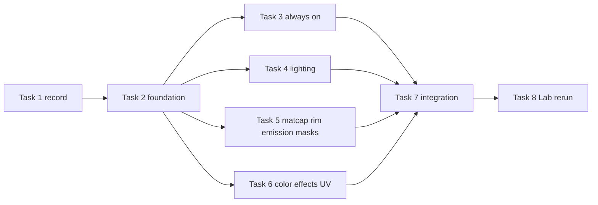

# Reviewed Poiyomi 9.3 atlas route: Implementation Plan

> **For agentic workers:** REQUIRED SUB-SKILL: Use superpowers:subagent-driven-development (recommended) or superpowers:executing-plans to implement this plan task-by-task. Steps use checkbox (`- [ ]`) syntax for tracking.

Privacy note: this plan describes one private Census Lab test avatar by role only. It names no avatar, renderer, material, or texture asset. It gives private counts as ranges. It quotes no vendor source text.

**Goal:** Poiyomi materials on the bundled 9.3 shader atlas when every feature they turn on is one that the source review proves safe.

**Architecture:** A new route table `AtlasRouteTable.PoiyomiReviewedMainColor` uses the existing route types. Four static classes in `Editor/Semantics/Poiyomi/`, one per feature group, hold the allowed keywords, neutral textures, companion routes, table rules, and dead value families of their group. A helper builds the standard Poiyomi companion route from a texture name. A reviewed flag on `PoiyomiAdmittedSource` picks the new table for the two bundled rows only.

**Tech Stack:** C# for Unity 2022.3, NUnit EditMode tests, the installed `com.poiyomi.toon` package and its bundled 9.3 shader files.

**Spec:** `docs/superpowers/specs/2026-11-23-poiyomi-reviewed-atlas-route-design.md`. Executors read the spec and the committed review record of Task 1.

## Global Constraints

- A false positive is a failure: an admitted use must render the same after the build (spec, anti-goal 1).
- The allowed keyword list stays an allow list. A keyword the review did not class refuses with `KeywordNotAllowed` (spec, section 4).
- No second way to declare routes. Every route is an `AtlasCompanionRoute`. Every family is an `AtlasDeadValueFamily` (spec, anti-goal 3).
- A fact of one slot refuses that slot only (spec, anti-goal 4).
- Coordinate rule (spec, section 6): selector 0 is `Uv0` and needs `<T>_ST` = (1,1,0,0), `<T>Pan` = 0, and `<T>Stochastic` = 0 when it exists. Selectors 1, 2, 3, 4, 5, 8, 9 are `OtherCoordinates`. Selectors 6, 7, every other value, and NaN refuse with `RequiredValueNotHeld`.
- The reviewed table applies only to the bundled rows `.poiyomi/Old Versions/9.3/Poiyomi Toon` and `.poiyomi/Old Versions/9.3/Poiyomi Toon Two Pass`. The release 9.3.64 rows keep `PoiyomiMainColor`.
- Analysis, planning, and page build code stays vendor-agnostic. Only `Semantics/` and `Host/AtlasUseCapture.cs` learn about the new table.
- Tests load the installed shaders by their pinned GUIDs. No vendor source text or vendor asset enters the repository. Property names, keyword names, and line numbers are allowed.
- Every English string uses simple English: short sentences, no semicolons, no contractions.
- Docs and tests name no private asset. Lab results are ranges. Every status claim carries a date.
- Commit steps run only after the user authorizes commits for this branch. Work on a new branch `feature/poiyomi-reviewed-atlas-route` from `main`.

## Review Focus

1. A `PROP_<texture>` keyword that disagrees with its texture: the texture is assigned while the keyword is off, or the reverse. Expected: the route treats an assigned texture of a live feature as sampled, so both cases stay exact. Task 3 tests it.
2. The Two Pass row. Its second pass pair copies the base pass. Expected: the same verdict and the same render as the Toon row. Task 2 parameterizes the fixture by row, and Task 7 runs the end-to-end cases on both rows.
3. A selector value that is not a whole number, such as 0.5, or NaN. Expected: `RequiredValueNotHeld`. Task 2 tests the helper.
4. A clip or a property block that drives a companion selector, transform, or pan. Expected: `AnimatedRouteProperty` or `PropertyBlockOnRouteProperty`, never an admitted use. Task 2 tests it.
5. A material with two lighting mode keywords on at once. Expected: admitted only when the conditions of both modes hold. Task 4 tests it.

## Findings (2026-11-23, read-only)

- The bundled Toon shader declares 106 keywords in its base pass. The five review reports class 104. The other two, `FOG_EXP2` and `VERTEXLIGHT_ON`, are engine keywords. The shader declares 139 texture properties. The reports class all 139.
- The bundled Two Pass shader differs from the bundled Toon shader in three ways. It adds a second ForwardBase and ForwardAdd pass pair that copies the base pair under the define `SecondPassRunning`. It adds scalar two-pass, blend, and stencil properties. It adds two global mask blocks under `SecondPassRunning`. It adds no texture property and no keyword. The two pass pairs declare the same keywords.
- `AtlasUseCapture` checks the route required values (lines 366-376) before `CaptureCompanions` resolves the sampler (line 619). So a route that refuses at selector 0 never reaches the sampler switch.
- `AtlasUseCaptureTests.LoadInstalledPoiyomiShader` loads `PoiyomiSourceAttestation.CanonicalShaderGuid`. In the dev project that GUID resolves to the bundled Toon file. The Two Pass GUID is `PoiyomiSourceAttestation.TwoPassCanonicalShaderGuid`.

## File Structure

- Create `docs/superpowers/investigations/2026-11-23-poiyomi-reviewed-route-keywords.md`: the review record.
- Modify `Editor/Semantics/AtlasCompanionSampler.cs`: add `InlineLinearRepeat = 3`, `InlinePointRepeat = 4`, `InlineClamp = 5`.
- Modify `Editor/Host/AtlasUseCapture.cs`: sampler constants and cases, the gate in `AttestRow` and `TryAttestPoiyomi`.
- Modify `Editor/Semantics/Poiyomi/PoiyomiSourceAttestation.cs`: the reviewed flag.
- Modify `Editor/Semantics/AtlasRouteTable.cs`: the table `PoiyomiReviewedMainColor`.
- Create in `Editor/Semantics/Poiyomi/`:
  - `PoiyomiCompanionRoutes.cs`: the standard route helper.
  - `PoiyomiAlwaysOnRoutes.cs`, `PoiyomiLightingRoutes.cs`, `PoiyomiMatcapRimEmissionRoutes.cs`, `PoiyomiColorEffectsRoutes.cs`: one group each.
  - `PoiyomiLiveValues.cs`: the model, `DeclaredUniforms`, and the refused families.
- Create tests:
  - `Tests/Editor/Host/PoiyomiReviewedFixture.cs`: a shared fixture.
  - `Tests/Editor/Semantics/Poiyomi/PoiyomiRenderHarness.cs`: a shared render helper.
  - `Tests/Editor/Semantics/Poiyomi/PoiyomiReviewedInventory.cs`: the pinned review inventory as test data.
  - `Tests/Editor/Semantics/Poiyomi/PoiyomiCompanionRoutesTests.cs`, `PoiyomiLiveValuesTests.cs`, `PoiyomiReviewedRouteTableTests.cs`.
  - One capture test file and one render test file per group, for example `PoiyomiLightingRoutesTests.cs` and `PoiyomiLightingLiveValuesRenderTests.cs`.
  - `Tests/Editor/Build/PoiyomiReviewedAtlasEndToEndTests.cs`.
- Docs: `README.md`, `Packages/com.alrauna.amuse/CHANGELOG.md`.

Every new file gets its `.meta` file from Unity. Never hand-write a GUID.

## Execution order

Tasks 3 to 6 run in parallel. Each edits only its own group file and its own test files. Each group task runs only its own test files. Task 7 runs the full assemblies once.

---

### Task 1: The review record

**Files:**
- Create: `docs/superpowers/investigations/2026-11-23-poiyomi-reviewed-route-keywords.md`

**Interfaces:**
- Produces: the record that Tasks 2 to 6 read. Use the section layout of `docs/superpowers/investigations/2026-11-19-atlasing-route-tables.md`: Question, Method, Decision, then the data sections below, then Falsifiers and Limits.

- [ ] **Step 1: Assemble the record from the five session review reports.** The main agent owns this task, because the reports are session artifacts.
  - Keyword table: all 104 vendor keywords. Columns: keyword, group (Always on, Lighting, Matcap rim emission masks, Color effects UV, KeyOnly, Refused), verdict (KeyOnly, Companion, Conditional, Refuse), source lines of the gate.
  - Texture table: all 139 texture properties. Columns: texture, group, class (member, member copy, neutral, companion, refused feature), sampler (`sampler_MainTex`, own, or the named inline sampler), selector property, transform property, pan property, stochastic property, exceptions, source line of each sample.
  - Conditional rules: one row per rule of spec section 7.2, with the properties it reads and their declared types.
  - Dead value families: one row per keyword. The properties that only that keyword's code reads.
  - The Two Pass finding of this plan.
- [ ] **Step 2: Re-read the sampler of every companion at its sample line.** A wrong sampler is a false positive. Mark each verified row.
- [ ] **Step 3: Sweep the record.** No semicolons. No vendor source text. No identifiers from the generic rules.
- [ ] **Step 4: Commit** `docs(atlas): record the Poiyomi 9.3 route review`.

### Task 2: Foundation

**Files:**
- Modify: `Editor/Semantics/AtlasCompanionSampler.cs`, `Editor/Host/AtlasUseCapture.cs` (sampler constants near line 554, the switch near line 619, `AttestRow` lines 1108-1151, `TryAttestPoiyomi` lines 1195-1246), `Editor/Semantics/Poiyomi/PoiyomiSourceAttestation.cs` (lines 43-141), `Editor/Semantics/AtlasRouteTable.cs`
- Create: `PoiyomiCompanionRoutes.cs`, the four group files as stubs, `PoiyomiLiveValues.cs`
- Test: `PoiyomiReviewedFixture.cs`, `PoiyomiRenderHarness.cs`, `PoiyomiReviewedInventory.cs`, `PoiyomiCompanionRoutesTests.cs`, `PoiyomiLiveValuesTests.cs`, `PoiyomiReviewedRouteTableTests.cs`

**Interfaces:**
- Consumes: the Task 1 record.
- Produces:
  - `PoiyomiAdmittedSource.AtlasRouteReviewed` (`bool`). It is true on the two bundled rows only.
  - `AtlasCompanionSampler.InlineLinearRepeat = 3`, `InlinePointRepeat = 4`, `InlineClamp = 5`.
  - `internal static class PoiyomiCompanionRoutes`:
    - `AtlasCompanionRoute Standard(string texture, AtlasCompanionSampler sampler, string[] featureKeywords, bool hasStochastic)`. It reads `<T>UV`, `<T>_ST`, `<T>Pan`, and `<T>Stochastic` when `hasStochastic` is true.
    - `AtlasCompanionRoute ClampSampled(string texture, string[] featureKeywords, bool hasStochastic)`. Sampler `InlineClamp`.
    - `Func<Material, bool, AtlasRouteUse> SelectorUse(string selectorProperty, string[] featureKeywords)`.
    - `string UnheldSelector(Material material, string selectorProperty)`.
    - `bool AnyEnabled(Material material, string[] keywords)`. An empty list means always on.
  - Each group class (`PoiyomiAlwaysOnRoutes`, `PoiyomiLightingRoutes`, `PoiyomiMatcapRimEmissionRoutes`, `PoiyomiColorEffectsRoutes`) is an `internal static class` with these members. In this task each member is empty, and `UnheldRequiredValue` returns null.
    - `string[] AllowedKeywords`
    - `string[] NeutralTextures`
    - `string[] ConditionProperties`
    - `AtlasCompanionRoute[] Routes()`
    - `string UnheldRequiredValue(Material material)`
    - `AtlasDeadValueFamily[] Families()`
  - `AtlasRouteTable.PoiyomiReviewedMainColor`. It concatenates the old `PoiyomiMainColor` data, the KeyOnly keywords and neutrals of spec section 7.1, and the four group classes. Its required value function returns the first non-null of the main color rule and the four group rules, in group order.
  - `PoiyomiLiveValues.Model` (`AtlasLiveValueModel`). It holds the refused families of spec section 7.3, the families of the four group classes, and `DeclaredUniforms`.
  - `PoiyomiLiveValues.RefusedKeywords` (`string[]`).
  - `PoiyomiReviewedFixture : IDisposable` (test). Members:
    - `Material NewMaterial(bool twoPass)`
    - `Texture2D NewRouteTexture(int size)`
    - `AtlasUseOutcome CaptureSingle(Material material, Mesh mesh = null, CommittedControllerGraphResult graph = null)`
    - `string MaterialKeyOf(Material material)`
    - `void AnimateScalar(GameObject root, string property)`
    - `static void AssertAdmitted(AtlasUseOutcome outcome)`
    - `static void AssertRefused(AtlasUseOutcome outcome, AtlasUseRefusal expected, string detailFragment)`
    Mirror the private helpers of `AtlasUseCaptureTests`. Do not edit that file.
  - `PoiyomiRenderHarness.Render(Material material) -> Color32[]` (test). A lit sphere into a 64 x 64 ARGB32 texture. One directional light with shadows on a receiver plane and one point light, as in `LilToonLiveValuesRenderTests`.
  - `PoiyomiReviewedInventory` (test data from the record). Members:
    - `IReadOnlyList<(string Texture, string Group, string Class)> Textures`
    - `IReadOnlyList<(string Keyword, string Group, string Verdict)> Keywords`
    - `IReadOnlyCollection<string> EngineKeywords`

- [ ] **Step 1: Write the failing tests.**
  - `PoiyomiReviewedRouteTableTests`:
    - `BundledRowsCarryTheReviewedFlag`: the two bundled rows are true. The two release rows are false.
    - `--- Falsifier 1: ReleaseRowKeepsThePlainRoute ---`: a material whose attested row is a release row gets `PoiyomiMainColor`. Use a stand-in row seam only if the release file is not installed. Then record why.
    - `ShaderInventoryMatchesTheReviewedRecord` (both rows): the texture property names of the shader equal `Textures`. The keyword names of `shader.keywordSpace` minus `EngineKeywords` equal `Keywords`.
    - `ReviewedTableKeepsEveryPlainEntry`: each member, neutral, keyword, condition, and transform of `PoiyomiMainColor` is in the new table.
    - `FreshBundledMaterialIsAdmittedOnBothRows`.
  - `PoiyomiCompanionRoutesTests` (both rows):
    - `SelectorZeroMovesTheTexture`: an assigned `_BumpMap` at selector 0 is a companion.
    - `--- Falsifier 2: OtherSelectorsKeepTheTextureBound ---`: one case each for 1, 2, 3, 4, 5, 8, 9. The texture stays bound. No companion.
    - `--- Falsifier 3: PolarAndDistortedSelectorsRefuse ---`: 6 and 7 refuse. The detail names the selector property.
    - `--- Falsifier 4: FractionalOrNaNSelectorRefuses ---`: 0.5, 10, -1, and NaN refuse.
    - `--- Falsifier 5: NonIdentityTransformOrPanRefuses ---`: `NonIdentityTransform` for each.
    - `--- Falsifier 6: StochasticFlagRefuses ---`.
    - `--- Falsifier 7: AnimatedSelectorRefuses ---` and `PropertyBlockOnSelectorRefuses`.
    - `ClampSampledTextureRefusesOnlyAtSelectorZero`: a test-local route through `ClampSampled`. Selector 0 refuses. Selector 3 is `OtherCoordinates`.
    - `InlineSamplerCompanionsUseTheirFacts`: `InlineLinearRepeat` gives bilinear repeat, `InlinePointRepeat` gives point repeat. Both have anisotropy 0 and bias 0.
  - `PoiyomiLiveValuesTests`:
    - `DeclaredUniformsCoverTheSource`: scan both installed bundled files. Every uniform declaration name, every texture declaration name, and every Properties name is in `DeclaredUniforms`. A failure lists the missing names.
    - `FamiliesNameOnlyDeclaredProperties` and `FamiliesNeverHoldASwitch`, as in `LilToonLiveValuesTests`.
    - `RefusedFeatureTextureWithItsKeywordOffLeavesTheKey`: an assigned decal texture with every decal keyword off. Admitted. The key equals the key without the texture.
    - `--- Falsifier 8: RefusedKeywordOnStillRefuses ---`: the same texture with its decal keyword on refuses with `KeywordNotAllowed`.
- [ ] **Step 2: Run the three Task 2 test classes.** Expected: they fail to compile, or they fail with the missing table, flag, helper, and enum values.
- [ ] **Step 3: Implement.**
  - The flag is a new last constructor parameter of `PoiyomiAdmittedSource`. Each row sets it explicitly.
  - `TryAttestPoiyomi` gains `out bool atlasRouteReviewed`. `AttestRow` picks `PoiyomiReviewedMainColor` when it is true. A code comment names the review date, as the lilToon gate does.
  - Sampler constants: `InlineLinearRepeat` is `FilterMode.Bilinear`, Repeat on both axes, 0, 0f. `InlinePointRepeat` is `FilterMode.Point`, Repeat on both axes, 0, 0f. The `InlineClamp` case throws `InvalidOperationException`, because a clamp route refuses at selector 0 before the sampler step.
  - `SelectorUse` returns `Inert` when no feature keyword is on, `OtherCoordinates` for 1, 2, 3, 4, 5, 8, 9 by exact compare, and `Uv0` otherwise. `UnheldSelector` returns a sentence for every `Uv0` value except exactly 0. The route's unheld function then checks the stochastic flag.
  - `ClampSampled` returns a sentence for selector 0 too: "The texture '<T>' samples with a clamp sampler on UV0. The route needs a selector other than 0."
  - Each route's condition properties are its selector, transform, pan, and stochastic names.
  - `DeclaredUniforms` is a pinned string array in `PoiyomiLiveValues.cs`, generated once from the scan and checked in.
  - The four group stubs compile with empty members.
- [ ] **Step 4: Run the three Task 2 test classes, `AtlasUseCaptureTests`, and `AtlasEndToEndTests`.** Expected: all pass. A 0-test filter is a failure.
- [ ] **Step 5: Commit** `feat(atlas): add the reviewed Poiyomi route foundation`.

### Tasks 3 to 6: One feature group each

These four tasks share one shape. They run in parallel. Each owns one group file, one capture test file, and one render test file. The group's rows in the Task 1 record are the source of truth.

**Interfaces (all four):**
- Consumes: `PoiyomiCompanionRoutes`, `PoiyomiReviewedFixture`, `PoiyomiRenderHarness`, `PoiyomiReviewedInventory` from Task 2.
- Produces: the filled members of the group class. No other file changes.

**Steps (all four):**

- [ ] **Step 1: Write the capture tests** in `Poiyomi<Group>RoutesTests.cs`, on both rows.
  - `GroupInventoryIsRouted`: for each texture of the group in `PoiyomiReviewedInventory`, the table classes it as the inventory says. For each keyword of the group, the allowed list holds it.
  - One `<Feature>IsAdmitted` test per feature. The feature keyword is on. Each of its companions is assigned at selector 0.
  - One falsifier per condition of the group, named in the task below. Mark each one `--- Falsifier N: ... ---`, numbered from 1 in each test file. Each falsifier has a no-op guard that asserts the admitted twin first.
- [ ] **Step 2: Write the render tests** in `Poiyomi<Group>LiveValuesRenderTests.cs`.
  - `DeadFamilyValuesDoNotChangeTheRender`: one case per family of the group. Turn every other group keyword of the record on. Turn the family keyword off. Perturb every family property: a float + 0.37, a color or vector + 0.37 per channel, a texture to a 4 x 4 noise texture. The readbacks are equal byte for byte. No-op guard: `DeadProperties` holds every perturbed name.
  - `LiveFamilyValueChangesTheRender`: one liveness case per family. The keyword is on, and the same perturbation changes the readback.
- [ ] **Step 3: Run both group test files.** Expected: the inventory test and the admission tests fail on the empty stubs. Record the failures.
- [ ] **Step 4: Fill the group class from the record.** Use `Standard` for each standard texture. Write each exception by hand, in the style of `LilToonCompanionRoutes`. Each table rule returns the first failing sentence, in the form "The property '<name>' is <value>. The route needs <rule>."
  - Each family has one feature keyword as its only switch. `IsOff` is true when `material.IsKeywordEnabled(keyword)` is false.
  - A `PROP_<texture>` keyword never gates a family or a route. The Thry editor can leave it out of step with its texture.
- [ ] **Step 5: Run both group test files.** Expected: all pass. A failing render case is a data defect. Move the named property out of the family. Never loosen the comparison.
- [ ] **Step 6: Commit** `feat(atlas): admit the reviewed Poiyomi <group> features`.

### Task 3: Always on

**Files:** `Editor/Semantics/Poiyomi/PoiyomiAlwaysOnRoutes.cs`, `Tests/Editor/Semantics/Poiyomi/PoiyomiAlwaysOnRoutesTests.cs`, `Tests/Editor/Semantics/Poiyomi/PoiyomiAlwaysOnLiveValuesRenderTests.cs`

- Companions: `_BumpMap`, `_AlphaMask`, `_LightingAOMaps`, `_LightingDetailShadowMaps`, `_LightingShadowMasks`, `_OutlineMask`, `_OutlineTexture`. Each `PROP_<texture>` keyword of these textures is allowed.
- Table rule: `_LightingMapMode` is not 4.
- Falsifiers:
  - `LightMapModeFourRefuses`. The detail names `_LightingMapMode`.
  - `PropKeywordOffWithAssignedTextureIsStillACompanion` (Review Focus 1). `_BumpMap` assigned, `PROP_BUMPMAP` off. The texture is a companion, not an unlisted texture and not a dead value.
  - `PropKeywordOnWithUnassignedTextureIsAdmitted` (Review Focus 1).
  - `CompanionThatIsTheMainTextureAliases`: `_BumpMap` set to the `_MainTex` asset with the member sampler. The capture records an alias and makes no second page.

### Task 4: Lighting

**Files:** `Editor/Semantics/Poiyomi/PoiyomiLightingRoutes.cs`, `Tests/Editor/Semantics/Poiyomi/PoiyomiLightingRoutesTests.cs`, `Tests/Editor/Semantics/Poiyomi/PoiyomiLightingLiveValuesRenderTests.cs`

- Keywords and companions: the Lighting row of spec section 7.2.
- Table rules: texture ramp (`_ToonRampCount` at most 1, or `_ToonRampUVSelector` not 0). SDF mode (`_SDFShadingTexture` unassigned, or its selector not 0). Multilayer border mask (`_ShadowBorderMaskLOD` is 0). Mochie split mask (its own selector, merged transform, pan, and stochastic rules from the record).
- The stale enum rule: each lighting rule runs when its own mode keyword is on, whatever other mode keyword is on.
- Falsifiers: one per table rule. Plus `TwoLightingModesNeedBothConditions` (Review Focus 5): realistic and SDF mode keywords both on, with the SDF texture at selector 0. Refused. The same with the SDF selector at 1. Admitted.

### Task 5: Matcap, rim, emission, and masks

**Files:** `Editor/Semantics/Poiyomi/PoiyomiMatcapRimEmissionRoutes.cs`, `Tests/Editor/Semantics/Poiyomi/PoiyomiMatcapRimEmissionRoutesTests.cs`, `Tests/Editor/Semantics/Poiyomi/PoiyomiMatcapRimEmissionLiveValuesRenderTests.cs`

- Keywords and companions: the matcap, rim, emission, and masks row of spec section 7.2. The four matcap textures stay neutral.
- Table rules: matcap blend (the `UVToBlend` selector is not 0, 6, or 7, or the blend vector is zero). Emission center-out off when the map is on selector 0. Emission scrolling curve off or unassigned. Global masks: split transforms are identity and split pans are zero.
- Falsifiers: one per table rule. Plus `MatcapTextureIsNeutralAtAnySelector`: a matcap texture stays bound and is no companion.

### Task 6: Color, effects, and UV

**Files:** `Editor/Semantics/Poiyomi/PoiyomiColorEffectsRoutes.cs`, `Tests/Editor/Semantics/Poiyomi/PoiyomiColorEffectsRoutesTests.cs`, `Tests/Editor/Semantics/Poiyomi/PoiyomiColorEffectsLiveValuesRenderTests.cs`

- Keywords and companions: the color, effects, and UV row of spec section 7.2. `_UzumoreMask` uses `ClampSampled` unless the record shows another sampler.
- Table rules: distortion (`_DistortionUvToDistort` not 0). Dissolve UV tile off or not on UV0. All four text selectors not 0. Vertex wind off when `_VertexBasicsMask` is a companion. Parallax, truchet, AL decal, and AL volume color selectors not 0. Voronoi space not UV. UV tile discard (all row flags zero, or the selector not 0). Pathing source not UV on UV0. Video (pixelate off, CRT off, pixel texture not on UV0). AudioLink UV debug modes and CC strip Y off.
- Falsifiers: one per table rule. Plus `ParallaxAtItsDefaultSelectorRefusesWithItsSelectorName` (spec section 7.2, the default-refusal note). Plus `UzumoreMaskAtDefaultSelectorIsAdmitted`.

### Task 7: Integration, end-to-end, and docs

**Files:**
- Test: `Tests/Editor/Semantics/Poiyomi/PoiyomiReviewedRouteTableTests.cs`, `Tests/Editor/Build/PoiyomiReviewedAtlasEndToEndTests.cs`
- Modify: `README.md` (atlas section), `Packages/com.alrauna.amuse/CHANGELOG.md`

**Interfaces:**
- Consumes: the filled group classes from Tasks 3 to 6.

- [ ] **Step 1: Write the completeness tests** in `PoiyomiReviewedRouteTableTests`, on both rows.
  - `EveryTexturePropertyIsClassified`: each texture is the member, a member copy, a neutral, a companion route, or a texture of a refused family.
  - `EveryVendorKeywordIsAllowedOrRefused`: `keywordSpace` names minus `EngineKeywords` equal the allowed list plus `RefusedKeywords`. No keyword is in both lists.
  - `EveryReadPropertyExists`: every selector, transform, pan, stochastic, and condition property of every route, and every property a table rule reads, exists on the row with the type the record names.
  - `EveryKeywordHasAFamily`: each allowed and refused keyword that the record gives dead properties has a family.
- [ ] **Step 2: Write `PoiyomiReviewedAtlasEndToEndTests`.** One case per feature group, on each row. Two materials turn on the group's features with companion textures at selector 0. Build. Assert both slots share one page set. Render the source and the build with `PoiyomiRenderHarness`. The largest channel difference is at most 1.
- [ ] **Step 3: Run both files.** Expected: all pass. A completeness failure names a texture, keyword, or property. Fix the owning group file. Never edit the inventory to match the code.
- [ ] **Step 4: Update the docs.**
  - `README.md`: Poiyomi materials on the bundled 9.3 shader atlas with the features that the review admits. Name the refused features: decals, internal parallax, flipbook, glitter, and selectors 6 and 7.
  - `CHANGELOG.md`: one dated `Added` entry.
  - Spec status: implemented on the date of this step.
- [ ] **Step 5: Run the full `Alrauna.Amuse.Tests.Editor` and `Alrauna.Amuse.Research.Tests.Editor` assemblies.** Expected: 0 failures. Record the observed counts.
- [ ] **Step 6: Sweep the changed docs for identifiers.** Run `git diff --check`.
- [ ] **Step 7: Commit** `docs(atlas): describe the reviewed Poiyomi route`.

### Task 8: Census Lab rerun

The main agent runs this task, read-only.

- [ ] **Step 1: Check that `Application.dataPath` of the Census Lab editor instance ends with `/AMUSE-Census-Lab/Assets`.** Stop on any other value.
- [ ] **Step 2: Rerun the atlas analysis on the test avatar** with the reflection recipe of 2026-11-23: `AtlasAnalysis.Analyze` over `CommittedControllerGraph.Enumerate` and the VRChat platform bindings.
- [ ] **Step 3: Add a dated results section to the Task 1 record.** Give the admitted uses and the refusals per cause as ranges. Name each remaining refused feature by keyword. Name no asset.
- [ ] **Step 4: Sweep the record. Commit** `docs(atlas): record the Lab rerun of the Poiyomi route`.

## Assumptions and contingencies

- The Lab project must hold the same bundled shader bytes as the dev project. If the Lab attests a different digest, the rerun reports `UnattestedShader`. Then stop and report it.
- If `keywordSpace` on a row lists a vendor keyword that the record does not class, the inventory test fails in Task 2. Then stop and review the keyword before Tasks 3 to 6 start.
- If a render case cannot reach a state with the vendor shader, a stand-in is allowed only for that case. Record the reason in the test.
- Two Pass coverage rests on the 2026-11-23 diff in this plan. The completeness tests run on both rows, so a future Two Pass texture or keyword fails them.
